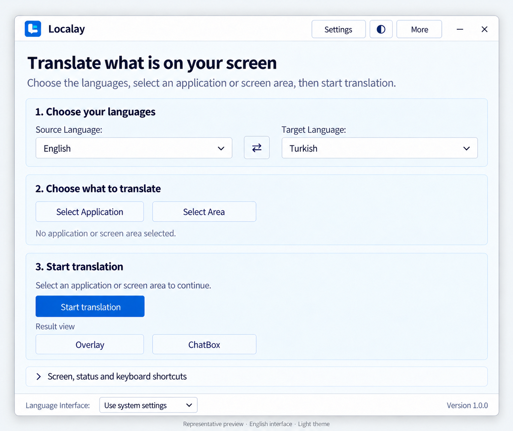

<p align="center">
  
</p>

<h1 align="center">Localay</h1>

<p align="center">
  Real-time game localization for Windows.<br>
  An open-source project by <a href="https://www.alpwarestudio.com/en/products/">AlpWare Studio</a>.
</p>

<p align="center">
  <a href="https://github.com/mahmutaunal/Localay/releases">Downloads</a> ·
  <a href="#quick-start">Quick start</a> ·
  <a href="#build-from-source">Build from source</a> ·
  <a href="https://github.com/mahmutaunal/Localay/issues">Report an issue</a>
</p>

Localay captures text from your selected game window, recognizes it with OCR, and translates it into your chosen language. Read the result over the game—without modifying game files or injecting code into the game process.



*Representative preview of the English interface in light theme; not an actual Windows screenshot.*

## Features

- **Translate visible game text:** subtitles, dialogue, menus, quests, tutorials, and item descriptions.
- **Choose your game:** select the open game window.
- **Read over the game:** translations use the overlay automatically.
- **Stable reading layout:** changing dialogue at a shared lower-center location can use a fixed, opaque subtitle panel. Other text uses simple boxes anchored to its source.
- **Choose your languages:** English → Turkish is the default; source and target languages can be changed.
- **Follow your system preferences:** automatic interface language and theme selection, with manual overrides in Settings.
- **One engine per session:** Hy-MT2 local AI through Ollama, or the existing keyless Google web service; no competing model or automatic provider fallback.
- **Keep controls within reach:** configurable shortcuts, reusable profiles, and optional clipboard translation.
- **Reduce repeated work:** frame-change detection and translation caching limit unnecessary processing.
- **Prefer current dialogue:** changed game text cancels obsolete translation and prefetch work, even when a HUD label stays unchanged. Cached translations remain reusable; providers that ignore cancellation must still exit before the next request starts.

## Requirements

- Windows 10 version 2004 (build 19041) or newer; Windows 11 recommended.
- An x64 PC.
- The Windows OCR language feature for the language you want to recognize.
- An internet connection for online translation, or a configured local translation service and model for offline use.

Published builds include the .NET runtime. You do not need to install .NET separately to run Localay. Available recognition and translation languages depend on the OCR engine and translation provider.

## Installation

### Windows installer

Download `Localay-<version>-Setup-x64.exe` from the latest release on [GitHub Releases](https://github.com/mahmutaunal/Localay/releases), then run it to install Localay.

The short setup installs Localay for the current user without requesting administrator privileges. It adds a Start menu shortcut and offers an optional desktop shortcut. You can uninstall it through Windows Settings; user settings and credentials are retained.

To get a build directly from GitHub Actions:

1. Open **Actions → Build Windows Installer** in the [GitHub repository](https://github.com/mahmutaunal/Localay/actions) and select a successful run.
2. Download the **Localay-Setup-windows-x64** artifact.
3. Extract the downloaded archive, then run the setup EXE inside it.

See the [installer guide](installer/README.md) for artifact contents, checksums, and installation validation.

### Portable version

The **Localay-Portable-windows-x64** Actions artifact contains the portable package. Extract the package into a folder and launch `Localay.exe`. Keep all included files together.

## Quick start

For local AI, open **Translation settings → Use local AI → Save**, then **Prepare model** after installing Ollama. See the [one-time Hy-MT2 setup](docs/hymt2-setup.md). The main screen shows the saved engine; Settings shows pending edits until saved. Existing provider preferences are preserved, and Google web remains the default when no provider was configured. Neither path needs a paid translation API.

1. **Choose your game.** Open the game, choose **Choose game** in Localay, and select its window.
2. **Choose your languages.** Set the language visible in the game and the language you want to read. English → Turkish is the default; source language selection is manual.
3. **Start translating.** Choose **Start translation**, then switch to the selected game. The overlay appears while that game is in front. Switching away or minimizing the game hides the overlay and suspends processing; returning resumes automatically. A manual pause requires Resume. There is no screen-area or output-mode setup.

Use **More → Settings** to change the translation provider, interface language, theme, capture behavior, and shortcuts. On Windows 10, overlay mode requires a selected application window.

The subtitle panel learns its location from different source texts at the same lower-center anchor. Until there is enough evidence, text uses ordinary UI boxes. The panel covers the original subtitle only when its full translation fits and no other detected text would be hidden. Text that cannot fit safely remains uncovered. Game overlays use opaque backgrounds and viewport-based text sizes rather than recreating the original font or repairing background pixels.

OCR accuracy depends on text size, contrast, font, and animation. Compatibility can also vary with HDR, exclusive fullscreen, and game protection policies. Try borderless or windowed mode if capture or overlays do not work as expected.

## Translation providers

| Option | Setup | Connection and cost |
| --- | --- | --- |
| Hy-MT2 1.8B through Ollama | One-time local model installation; exact model tag in the setup guide | Local translation, no translation API account or usage fee. Published language support is checked before dispatch. |
| Google Translate web | Existing default; no API key or billing setup | Internet required; service availability and limits apply. No Cloud translation API calls in game batches. |

Other legacy adapters remain in Settings but do not satisfy game-start readiness. Each session uses only its selected engine. Game batches reject Google Cloud dispatch; the web service retains its request spacing and rate limits. Hy-MT2 uses plain-text generation with IDs assigned by the application and publishes each ready block. Its integration checks use fake HTTP, not real inference or measured game latency. See the [engine decision and validation limits](docs/game-translation-engine.md).

An [English–Turkish game-text acceptance corpus](tests/TranslationQualityChecks/README.md) contains 60 original examples and review criteria. The [single-block web pilot](tests/TranslationQualityChecks/results/ASSESSMENT-2026-10-22.md) collected real outputs and failed the criteria in assistant review. This is not independent human validation or a test of game latency; reference translations are not inference results.

The [production batching comparison](tests/TranslationQualityChecks/results/BATCH-ASSESSMENT-2026-10-22.md) returned the same 60 translations through six web requests. Batching reduced the observed collection time but did not fix the meaning errors in this corpus.

## Privacy and security

Screen capture and OCR run on your PC. The game provider sends recognized text and the selected language codes to Google's web translation service. This adapter does not send Localay's conversation history or game-info prompt. Legacy non-game features can use other configured online or local providers.

- Clipboard translation is disabled by default and requires consent.
- Logging translation content requires a separate opt-in for each session.
- Settings are stored in `%LOCALAPPDATA%\AlpWare Studio\Localay`.
- API keys are protected for the current Windows user and excluded from shared profiles.

Localay is currently distributed without code signing. Windows SmartScreen, Smart App Control, antivirus software, or organizational policies may warn about or block an unsigned build. Release validation includes Microsoft Defender scanning, but a clean scan cannot guarantee that every security product will accept the executable. See [SECURITY.md](SECURITY.md) for release checks and false-positive reporting.

### Updates

Localay checks GitHub for a newer stable version in the background at most once a day. You can disable automatic checks in Settings → Help, or choose **Check for updates** there or in About. Downloads start only when you choose **Download update**. After the full installer passes size and SHA-256 checks, choose **Close and install**. Resolve any pending Settings edits; Localay then closes and opens the normal administrator-required setup, preserving saved settings and profiles. Setup offers to reopen Localay after installation.

Portable copies show update notifications but use **Official releases** for manual updates; extract the complete new portable package into a clean folder. See [UPDATES.md](UPDATES.md) for the manual release checklist and verification limits.

## Build from source

Use the .NET SDK selected by [global.json](global.json). PowerShell 7 is required for the validation and packaging scripts. Windows is required to run the application and validate the installer.

```powershell
dotnet restore ./Localay.csproj -r win-x64 --locked-mode
dotnet build ./Localay.csproj -c Release -r win-x64 --no-restore
```

Run the project checks from PowerShell 7:

```powershell
./Verify-Project.ps1
```

For setup and portable packages, use the **Build Windows Installer** GitHub Actions workflow. You can trigger it from a Mac through **Actions → Build Windows Installer → Run workflow**. The workflow builds on Windows and validates the packages before uploading artifacts.

See [BUILD.md](BUILD.md) for local build, publishing, and validation instructions, and the [installer guide](installer/README.md) for packaging details.

## Contributing

Bug reports and focused improvements are welcome. Read [CONTRIBUTING.md](CONTRIBUTING.md) before submitting a pull request.

For bugs, open an [issue](https://github.com/mahmutaunal/Localay/issues) with your Windows version, Localay version, selected OCR and translation providers, and steps to reproduce the problem. Remove API keys and private content from logs or screenshots. Follow [SECURITY.md](SECURITY.md) for security-related reports.

## License and acknowledgments

Localay is licensed under [GNU GPL v3.0](LICENSE.md) and is derived from **RSTGameTranslation** by Thanh Pham. Original attribution and license notices are preserved.

See [THIRD_PARTY_NOTICES.md](THIRD_PARTY_NOTICES.md) for dependencies and acknowledgments. License information is also available offline in **More → About Localay → Licenses and contributors**.

## AlpWare Studio

Developed by **AlpWare Studio**.

- [Explore our other projects](https://www.alpwarestudio.com/en/products/)
- [Source code on GitHub](https://github.com/mahmutaunal/Localay)
- [contact@alpwarestudio.com](mailto:contact@alpwarestudio.com)
